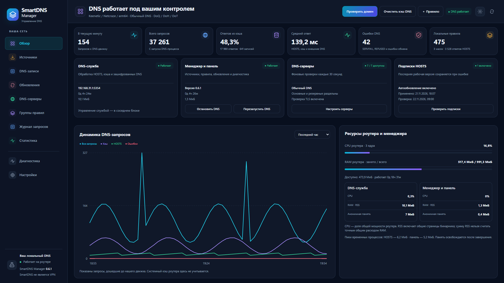
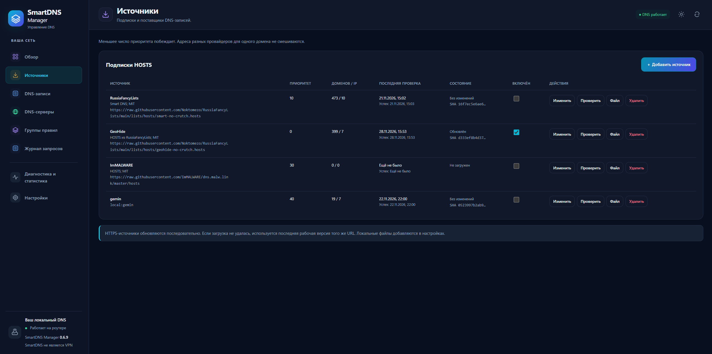
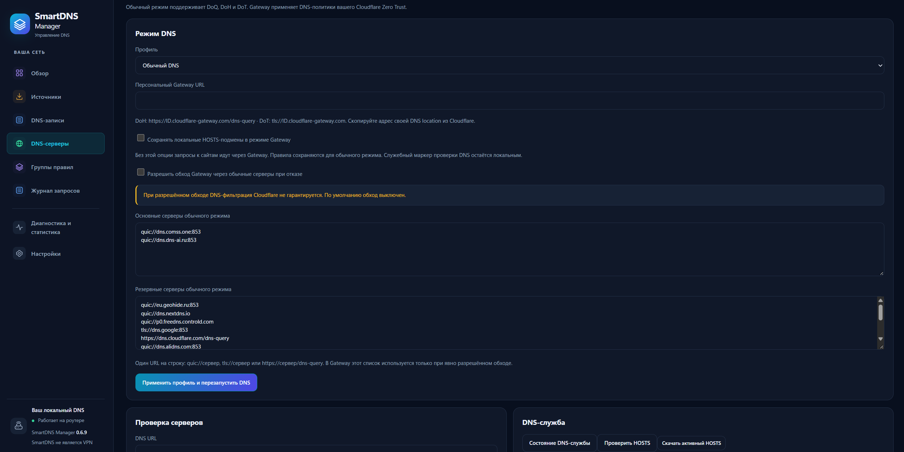
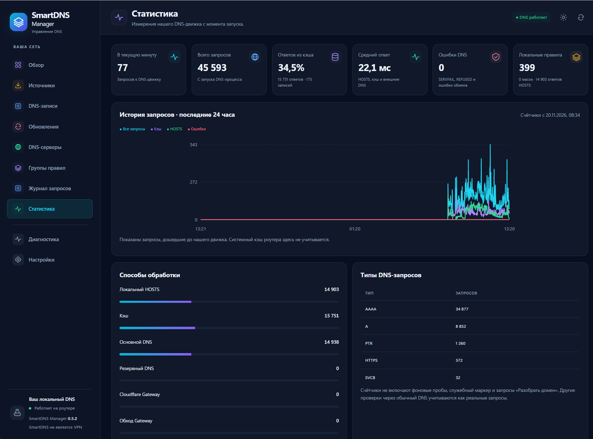

# SmartDNS Manager

**0.6.3 — DNS, менеджер и сервер веб-панели на C11.** Самостоятельный пакет для **Keenetic / Netcraze с Entware** и **OpenWrt**.

Один статический исполняемый файл, две независимые службы. Остановка панели не останавливает DNS. Обработка подписок, диагностика, экспорт и другие тяжёлые операции выполняются отдельными короткими процессами того же файла. После завершения операции их память возвращается системе.

Выпуск предназначен для **чистой установки**. Установка поверх существующего менеджера запрещена. Для повторной установки сначала выполните полное удаление; настройки и правила при этом удаляются. Обновления подписок HOSTS работают как обычно.

## Что изменилось в 0.6.3

- Keenetic устанавливает и запускает SmartDNS, затем добавляет его как дополнительный сервер на LAN IPv4:5354. Исходные серверы и профили сохраняются, включая DoH/DoT и DNS провайдера.
- Установщик проверяет прямой ответ SmartDNS и читает регистрацию обратно из KeeneticOS. Если штатный DNS ещё не передаёт запросы в SmartDNS, установщик сообщает об этом.
- Проверка восстановления использует реальные имена и принимает положительный ответ по UDP или TCP. Исходный DNS проверяется после остановки SmartDNS.

## Установка одной строкой

Одинаковая команда для обеих платформ. Выполните от root в SSH-терминале роутера:

```sh
(f=$(mktemp) && curl -fLsS --connect-timeout 15 --max-time 120 "https://raw.githubusercontent.com/shurshick/SmartDNS_Manager/main/install.sh?t=$(date +%s)" -o "$f" && sh "$f"; r=$?; [ -z "${f:-}" ] || rm -f "$f"; exit "$r")
```

**Оставьте текущий DNS включённым до запуска установщика.** Он нужен для скачивания пакета. Установщик определяет платформу и архитектуру, скачивает только подходящий архив, проверяет закреплённый SHA-256 и каждый файл внутри.

**Keenetic.** После установки проверьте сообщение о прохождении запросов. Штатные DoH/DoT могут иметь приоритет над SmartDNS. Если хотите направить через SmartDNS все запросы системного профиля, откройте настройки DNS в KeeneticOS и вручную отключите штатные DoH/DoT и другие DNS-серверы. Перед этим сохраните их параметры для последующего восстановления. Другие профили фильтрации управляются отдельно.

**OpenWrt.** Установщик сохраняет настройки dnsmasq, проверяет SmartDNS и только затем переключает dnsmasq. При ошибке настройки восстанавливаются.

Панель: **http://LAN_IP:8092/**, например http://192.168.1.1:8092/. Она предназначена для доверенной локальной сети; авторизации в панели нет.

Если LAN IPv4 не определился, укажите его явно: `SDM_LAN_IP=192.168.31.1 sh install.sh` для уже скачанного скрипта. Проверка архива без установки: `sh install.sh --check`.

## Требования и платформы

| Платформа | Архитектуры |
|---|---|
| Keenetic / Netcraze, Entware | ARM64, MIPS LE, MIPS BE |
| OpenWrt, dnsmasq / UCI / procd | ARM64, ARMv7, MIPS LE, MIPS BE, amd64 |

ARMv7 использует VFPv3-D16, без требования NEON. MIPS — MIPS32 с программной плавающей точкой. Архитектуры автоматически различаются, включая порядок байтов MIPS.

Нужны root, `curl`, `sha256sum`, `tar`, рабочие корневые сертификаты, доступ к GitHub и правильное время для загрузки по HTTPS. Keenetic требует заранее установленный Entware и рабочий `ndmc` или `ndmq`; OpenWrt — штатный dnsmasq. Компилятор, Go, Python и Node на роутере не нужны.

Онлайн-установка скачивает **один архив примерно 1,7–2,3 МиБ**. Исполняемый файл после распаковки — примерно 3,4–5,0 МиБ; размеры зависят от архитектуры. Установщик требует минимум 6 МиБ свободного места в разделе установки; для выбранного архива и распаковки оставьте от 8 МиБ в `/tmp`. Подписки, кэши файлов и резервные копии дополнительно занимают место по своему размеру. Расход RAM зависит от правил, кэша, соединений и выполняемых операций; RSS двух служб нельзя просто складывать из-за общих страниц файла.

## Полное удаление

**Онлайн — одна команда для Keenetic / Netcraze и OpenWrt**, от root в SSH:

```sh
(f=$(mktemp) && curl -fLsS --connect-timeout 15 --max-time 120 "https://raw.githubusercontent.com/shurshick/SmartDNS_Manager/main/install.sh?t=$(date +%s)" -o "$f" && sh "$f" --uninstall; r=$?; [ -z "${f:-}" ] || rm -f "$f"; exit "$r")
```

Скрипт вызывает установленный на роутере менеджер. На Keenetic LAN IPv4 определяется из конфигурации; это позволяет удалить и 0.5.4. Если адрес не определился, передайте `SDM_LAN_IP=192.168.1.1` перед `sh` вместо автоматического определения.

**Локально, без скачивания скрипта**, для 0.6.3 на Keenetic / Netcraze:

```sh
/opt/sbin/smartdns-manager uninstall --yes
```

OpenWrt:

```sh
/usr/sbin/smartdns-manager uninstall --yes
```

Для локального удаления **0.5.4 на Keenetic** укажите LAN IPv4 явно:

```sh
/opt/sbin/smartdns-manager uninstall --platform keenetic --lan-ip 192.168.1.1 --yes
```

Подставьте адрес своего роутера. Локальное удаление не требует интернета; онлайн-команде интернет нужен только для скачивания скрипта.

При удалении установщик снимает собственную регистрацию и проверяет DNS без работающего SmartDNS. Если вы вручную отключили штатные DNS в KeeneticOS, включите их обратно перед удалением. Для предыдущих установок с сохранённым состоянием и для OpenWrt пакет восстанавливает настройки, которые менял сам. При успешной проверке удаляются службы, настройки, HOSTS, кэши и резервные копии SmartDNS. **Нужные данные заранее экспортируйте из панели на компьютер.**

## Как перейти на новую версию

Для **0.6.3 используется полное удаление и чистая установка**. Автоматического обновления приложения с сохранением настроек нет; повторный запуск команды установки поверх существующей версии завершится отказом.

1. Экспортируйте нужные данные из панели на компьютер. Сохраните адрес Gateway, свои DNS-серверы, источники и правила для повторной настройки.
2. Выполните **команду онлайн-удаления выше**. Дождитесь успешного завершения. Если удаление завершилось ошибкой, установку не запускайте.
3. Выполните **команду онлайн-установки из начала README** — она скачает актуальную опубликованную версию для вашей платформы.
4. Откройте панель и настройте менеджер заново. Начальный режим — Обычный DNS; личный Gateway автоматически не переносится.

Это относится и к переходу **0.5.4 → 0.6.3**. Старый снимок сохраняйте как справочную копию; автоматический перенос настроек между этими выпусками не предусмотрен. Раздел «Обновления» в панели управляет подписками HOSTS, а не версией приложения.

## Автономная установка

Скачайте [автономный ZIP 0.6.3](https://github.com/shurshick/SmartDNS_Manager/releases/download/v0.6.3/SmartDNS-Manager-v0.6.3-offline.zip), распакуйте и передайте всю папку на роутер, например в `/tmp/smartdns-kit`.

```sh
cd /tmp/smartdns-kit
sh install-local.sh --check
```

Для Keenetic: `sh install-local.sh 192.168.1.1`, подставив свой LAN IPv4. Для OpenWrt: `sh install-local.sh`.

Комплект содержит восемь готовых пакетов и сам выбирает один. Скачивание программы с роутера не требуется. Для всего распакованного комплекта и выбранного пакета оставьте примерно 32 МиБ в `/tmp`. Интернет по-прежнему нужен для работы внешнего DNS, его проверки и загрузки подписок.

## DNS и правила

- DoQ (`quic://`), DoT (`tls://`) и DoH (`https://…/dns-query`), свои основные и резервные серверы. TLS-сертификаты проверяются.
- Фоновые проверки серверов, выбор доступных, повторное подключение после ошибок. Пулы основных и резервных серверов разделены.
- Cloudflare Gateway: персональный DoH URL или DoT hostname, переключение в панели. API-токен не нужен. Локальные правила и обход Gateway при отказе включаются отдельно. Отрицательный ответ DNS не считается отказом и не запускает обход.
- IPv4 и IPv6: локальные записи A/AAAA, внешние DNS по обеим семьям, собственное начальное разрешение имён через A/AAAA. При задержке IPv4 попытка IPv6 начинается через 200 мс. Для клиентов IPv6 действуют те же правила, если они используют штатный DNS роутера; раздача адресов DNS через RA/DHCPv6 зависит от прошивки.
- Кэш с уменьшением TTL и ограниченным размером. Перечитывание HOSTS атомарное: ошибка файла сохраняет рабочие правила.
- При неверном времени ограниченный список NTP-имён можно разрешить через начальный обычный DNS. Остальные домены не переключаются на незашифрованный DNS. Это не заменяет настройку NTP в прошивке.

По умолчанию включён **Обычный DNS**, без персонального Gateway. Семь основных серверов:

```text
quic://dns.quad9.net
quic://p0.freedns.controld.com
quic://dns.nextdns.io
quic://dns.comss.one
quic://dns.adguard-dns.com
quic://dns.alidns.com:853
quic://doq.ffmuc.net
```

## Подписки и группы

Включён начальный снимок RussiaFancyLists; он доступен сразу, без скачивания. В каталоге также есть GeoHide из RussiaFancyLists и ImMALWARE. Можно добавить свой HTTPS URL или локальный HOSTS-файл. Источники загружаются последовательно. При сетевой ошибке используется последняя рабочая версия того же URL. Адреса разных провайдеров для одного домена не смешиваются; побеждает меньший номер приоритета.

Есть точные правила, маски, исключения, ручной выбор IP, группы правил, предпросмотр изменений и резервные копии. Импорт групп включается **отдельно в настройках каждой подписки**. Распознаются секции источников и метки `# group:` / `# category:`. Группы сохраняют собственные идентификаторы и могут выключаться. При отключении импорта сохраняются настройки известных групп; смена URL не превращает старый кэш в данные нового источника. Источник без разделов не получает выдуманных групп.

Резкие изменения подписки требуют подтверждения конкретного снимка, если включена соответствующая защита. Число резервных версий настраивается.

## Панель и диагностика

- Главная: состояние служб, управление DNS, скорость и число запросов, кэш, ошибки, график, CPU и RAM роутера и обеих служб. Пики временных процессов показаны отдельно.
- DNS-серверы: доступность, задержки, ошибки, время проверок и схема обработки запроса.
- Проверка домена: фактический ответ и путь через HOSTS, кэш, основной/резервный DNS или Gateway, источник и группа правила.
- Журнал: кольцо последних 512 запросов в RAM, фильтры и прокручиваемый блок. Запись можно отключить; после перезапуска DNS журнал очищается. Он показывает запросы, дошедшие до SmartDNS, а не весь трафик устройств.
- Статистика: счётчики с запуска DNS и минутные данные за последние сутки. Штатный кэш роутера может ответить раньше, поэтому его попадания здесь не учитываются.
- Диагностика A/AAAA/HTTPS/SVCB, TCP/TLS по выбранным IP, сравнение с системным и публичным DNS, экспорт и восстановление собственных снимков.

SmartDNS управляет разрешением имён и **не является VPN**. Доступность внешних Smart DNS-сервисов зависит от их операторов. Маршрутизацию VPN пакет не настраивает.

## Архитектура ветки 0.6 и проверки

DNS, менеджер, управляющие команды и сервер панели перенесены на C11. В комплекте один статический файл. Убраны установка поверх старого приложения и перенос старой установки. Подписки HOSTS, их расписание и резервные копии сохранены.

Исправлена утечка памяти в json-c 0.19 при отключённых проверках `assert`: используется [исправление upstream](https://github.com/json-c/json-c/pull/936). Добавлен тест тысяч снимков статистики в готовых сборках. Тяжёлые операции вынесены из постоянного процесса панели; статистика DNS передаётся без повторного разбора всей истории.

Состав испытаний и результаты приведены в описании [текущего выпуска](https://github.com/shurshick/SmartDNS_Manager/releases/tag/v0.6.3). Эмуляция не заменяет проверку прошивки, перезагрузки и сети конкретного роутера. Выпуск отмечен предварительным до расширения аппаратных испытаний OpenWrt и остальных архитектур.

## Скриншоты

Главная показана в версии 0.6.1 на демонстрационных данных. Остальные скриншоты показывают разделы прежней версии; их оформление может отличаться.



<details><summary>Источники, серверы, журнал и статистика</summary>







</details>

## Состав и лицензии

В репозитории — установщик, описание и скриншоты. В выпуске — восемь пакетов, автономный ZIP и SHA256SUMS. Исходники приложения и прежние сборки хранятся локально.

Собственный код — MIT. Используются OpenSSL 3.5.9 (Apache-2.0), ngtcp2 1.26.0 (MIT), json-c 0.19 с исправлением f291fa8 (MIT), musl и компоненты Zig (MIT), Mozilla CA bundle (MPL-2.0), лицензированные начальные HOSTS и уведомления оформления. Полные лицензии и исходный PEM сертификатов включены в пакеты и установленный каталог данных.
