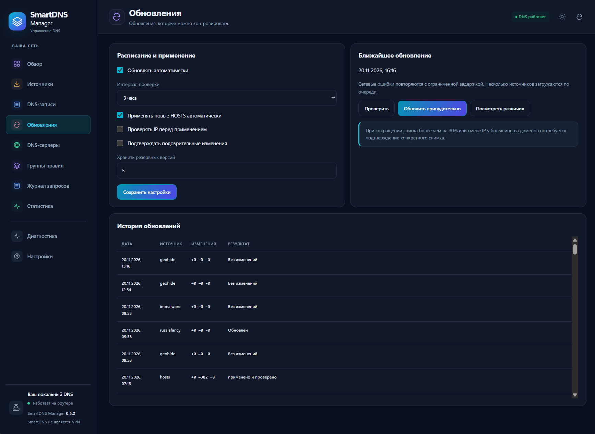
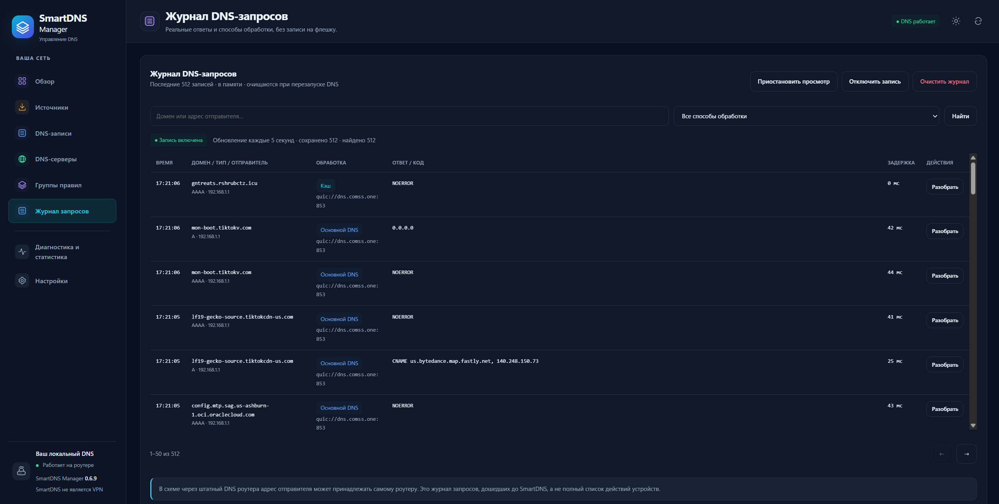

# SmartDNS Manager

**0.5.4 — подключение к DNS-серверам по IPv4 и IPv6 без DNS провайдера.**


Самостоятельный DNS-менеджер для **Keenetic / Netcraze с Entware** и **OpenWrt**. Один Go-бинарник, две независимые службы: DNS и веб-панель. Остановка панели не останавливает DNS.

## Что изменилось в 0.5.4

- Начальное разрешение имён серверов DoQ, DoT и DoH запрашивает A и AAAA через собственные DNS-адреса. DNS провайдера для этого не нужен. Если попытка IPv4 затягивается, подключение по IPv6 начинается через 200 мс.
- В штатный конфиг добавлены IPv6-адреса Cloudflare и Google для начального разрешения имён. При обновлении стандартный набор из прежней версии дополняется автоматически. Пользовательские списки адресов сохраняются.
- DNS роутера по-прежнему передаёт запросы движку по IPv4 внутри роутера. Для клиентов IPv6 действуют те же правила, если они используют штатный DNS роутера. Конфигурация раздачи DNS через RA/DHCPv6 зависит от прошивки.

## Что изменилось в 0.5.3

- Импорт групп DNS-правил включается отдельно для каждой подписки. SmartDNS распознаёт секции штатных источников и метки `# group: Название` в пользовательских HOSTS. Ручные назначения имеют приоритет. Состояние группы сохраняется при обновлении того же источника и секции.
- DNS-кэш хранит упакованные ответы и вытесняет по одной записи при заполнении. Журнал выдаёт страницу без копирования и сортировки всех 512 записей.
- Первый резервный DNS остаётся прогретым. Для остальных резервных DoQ и DoH соединения закрываются после 12 секунд простоя, а проверки по-прежнему выполняются каждые 30 секунд.
- Бэкапы HOSTS записываются порциями и сохраняют совместимость с прежним форматом.

## Установка одной командой

На Keenetic используйте эту команду для чистой установки с автоматической заменой глобальных ручных IPv4 DNS. Оставьте текущий DNS включённым до запуска, чтобы роутер мог скачать пакет с GitHub.

```sh
(f=$(mktemp) && curl -fLsS --connect-timeout 15 --max-time 120 "https://raw.githubusercontent.com/shurshick/SmartDNS_Manager/main/install.sh?t=$(date +%s)" -o "$f" && SDM_REPLACE_DNS=auto sh "$f"; r=$?; [ -z "${f:-}" ] || rm -f "$f"; exit "$r")
```

Установщик сам находит все подходящие записи, сохраняет их в журнале отката и снимает после прямой проверки SmartDNS. При ошибке установки он возвращает снятые записи. Режим выбирает только ручные IPv4 DNS на стандартном порту 53, без привязки к домену или интерфейсу. Если подходящих записей нет, установка продолжается обычным порядком. Чтобы заменить только один адрес, укажите его вместо `auto`.

Одинаковая команда для обеих платформ. Выполните от **root в SSH-терминале роутера**:

```sh
(f=$(mktemp) && curl -fLsS --connect-timeout 15 --max-time 120 "https://raw.githubusercontent.com/shurshick/SmartDNS_Manager/main/install.sh?t=$(date +%s)" -o "$f" && sh "$f"; r=$?; [ -z "${f:-}" ] || rm -f "$f"; exit "$r")
```

Установщик сам определит платформу, архитектуру и LAN IPv4 на Keenetic, скачает готовый пакет из GitHub Releases, сверит закреплённый SHA-256 и внутренние файлы. Затем штатный установщик проверит место и DNS, сохранит аварийную копию, запустит службы и проверит результат. При ошибке выполняется откат. **Сторонние DNS-пакеты не удаляются и не перезаписываются.**

Панель: **http://192.168.1.1:8092/**, если LAN-адрес роутера — 192.168.1.1. Панель предназначена для доверенной локальной сети, авторизации в ней нет.

### Перед установкой

- Keenetic / Netcraze: заранее установленный Entware, SSH обычно на порту 222. Используйте его shell, а не вложенный `exec sh` из CLI Keenetic.
- OpenWrt: штатные dnsmasq, UCI и procd; Entware не нужен.
- Нужны `curl`, рабочие корневые сертификаты, `sha256sum`, `tar`, доступ к GitHub и правильное время на роутере. Установка Entware и системных пакетов в команду не входит.
- Онлайн загружается только пакет вашей платформы. Для ARM64 архив занимает около 3,5 МиБ; архив вместе с распаковкой — около 13 МиБ в `/tmp`, нужен дополнительный запас. В разделе установки проверяется размер нового бинарника, аварийной копии и 8 МиБ резерва. Отдельной предварительной проверки свободного места в `/tmp` пока нет.
- Порты 5354 и 8092 должны быть доступны для новой установки. Существующий маршрут DNS не должен обходить локальный сервер через сторонние DoH/DoT-службы.

Если LAN IPv4 Keenetic не определился, скачайте тот же `install.sh` и запустите `SDM_LAN_IP=192.168.1.1 sh install.sh`, подставив свой адрес.

### Проверка без установки

```sh
(f=$(mktemp) && curl -fLsS --connect-timeout 15 --max-time 120 "https://raw.githubusercontent.com/shurshick/SmartDNS_Manager/main/install.sh?t=$(date +%s)" -o "$f" && sh "$f" --check; r=$?; [ -z "${f:-}" ] || rm -f "$f"; exit "$r")
```

Пакет скачивается, проверяется и распаковывается в `/tmp`. Рабочие службы и настройки не меняются. Проверка не заменяет испытания конкретной модели и прошивки.

## Что умеет

- Основные и резервные DNS через **DoQ, DoT и DoH**, смешанные списки URL.
- **Cloudflare Gateway** через персональный DoH URL или DoT hostname DNS location. Это DNS-подключение, WARP не устанавливается. Пользователь сам решает, нужны ли политики фильтрации в Cloudflare.
- HTTPS-подписки HOSTS, ручные записи, несколько IP, IPv6, wildcard, исключения и выбор источника.
- Просмотр различий, защита от массовой смены записей, атомарное применение, резервные копии и диагностика DNS.
- DNS продолжает работать при остановке менеджера.

URL серверов указываются по одному на строку:

```text
quic://dns.quad9.net
tls://dns.quad9.net
https://cloudflare-dns.com/dns-query
```

В Gateway по умолчанию локальные HOSTS-подмены сохранены, а обход через обычные серверы **выключен**. Если разрешить обход и применить профиль, оба обычных списка становятся резервом Gateway; фильтрация Cloudflare при таком обходе не гарантируется. Если отключить локальные подмены, запросы к сайтам идут в Gateway; служебный маркер проверки DNS остаётся локальным. Персональный endpoint и настройки рабочего роутера в сборки не включены.

## Диагностика и новый дашборд

- Счётчики запросов, средней задержки, ошибок, ответов HOSTS и попаданий в кэш; память и время работы двух процессов; состояние подписок и каждого активного DNS-сервера.
- Графики по минутам за час и 24 часа. Данные с момента запуска DNS; при его перезапуске журнал и статистика очищаются. После остановки панели DNS и его измерения продолжают работать.
- Журнал последних 512 запросов в оперативной памяти: домен, тип, адрес отправителя, ответ, способ обработки и задержка. Есть поиск, фильтр, страницы, пауза просмотра, очистка и отключение записи. Предпочтение записи сохраняется между перезапусками, сами запросы на флешку не записываются.
- «Проверить домен» выполняет настоящий запрос и объясняет правило, источник активного HOSTS, группу, исключение, кэш, фактический upstream и попытки перехода на резерв. Эта проверка помечается в журнале отдельно и не увеличивает счётчики обычного DNS.
- Группы правил: название, точные домены и маски, назначение из карточки правила, фильтр списка и общий переключатель. Сохранение готовит изменения; для изменения DNS нужно просмотреть и применить HOSTS. Отключение группы исключает её домены из подмен, включая поддомены wildcard. Записи не удаляются.
- Кнопка очистки сбрасывает только кэш нашего движка. Кэш штатного DNS роутера и браузеров не меняется.

При работе через штатный DNS адрес отправителя может принадлежать роутеру. Журнал не показывает запросы, на которые уже ответил системный кэш. Счётчики учитывают все дошедшие DNS-пакеты, в том числе обычные DNS-проверки применения HOSTS; фоновые проверки upstream, служебный маркер и новый разбор домена исключены. Рейтинг доменов строится только по сохранённому журналу, а не за всё время работы.

Источник и группа берутся из активного снимка, а не из ещё не применённых настроек. Старые снимки без метаданных показывают «Активный HOSTS»; сведения об источнике появятся при следующем применении HOSTS. При недоступной телеметрии панель показывает ошибку, а не вымышленные нули.

В панели нет VPN, FakeDNS и управления маршрутами. Запросы к DNS-службе обслуживаются независимо от панели. Панель обновляет данные через локальный сокет с доступом только владельцу; дополнительных сетевых портов нет.

## Скриншоты


<details>
<summary>Источники</summary>


</details>

<details>
<summary>Обновления</summary>



</details>

<details>
<summary>DNS-серверы</summary>


</details>

<details>
<summary>Журнал DNS-запросов</summary>



</details>

<details>
<summary>Статистика</summary>


</details>

## Восстановление после сбоев

При запуске и каждые 30 секунд DNS проверяет настроенные серверы. Отказавшие уходят в конец очереди, восстановившиеся возвращаются; соединение после подтверждённого отказа создаётся заново. В журнале отмечаются изменения доступности. NXDOMAIN от Gateway считается нормальным ответом, а не поводом обходить политику. Основной и резервный списки остаются раздельными.

Для загрузки со сбитыми часами **только точные имена стандартных NTP-серверов** разрешаются через обычный DNS на bootstrap IP, также в режиме Gateway. Проверка TLS-сертификатов сохраняется. Рабочий системный NTP исправляет время, затем зашифрованный DNS восстанавливается. Менеджер сам часы не меняет. Обычные домены этим исключением не пользуются.

Для своего сервера времени добавьте в DNS-конфиг `ntp_bootstrap clock.example.org`. `ntp_bootstrap off` очищает стандартный список; последующие строки добавляют только выбранные имена. По умолчанию включены pool.ntp.org, 0–3.pool.ntp.org, 0–3.openwrt.pool.ntp.org, time.cloudflare.com, time.google.com, time.windows.com, time.nist.gov и ntp.keenetic.net. Системный NTP должен быть включён, а его сервер доступен.

## Чистая установка и обновление

При **чистой установке** включён **обычный DNS**, все семь серверов ниже — основные:

```text
quic://dns.quad9.net
quic://p0.freedns.controld.com
quic://dns.nextdns.io
quic://dns.comss.one
quic://dns.adguard-dns.com
quic://dns.alidns.com:853
quic://doq.ffmuc.net
```

Если сеть не пропускает DoQ, при **чистой установке** можно явно выбрать один начальный DoH или DoT сервер: добавьте `SDM_INITIAL_UPSTREAM=https://cloudflare-dns.com/dns-query` непосредственно перед `sh "$f"` в команде установки. Это сохраняет обычный профиль; серверы затем меняются в панели. При обновлении параметр не заменяет существующие настройки. Автоматической подмены стандартного списка нет.

На Keenetic установщик сохраняет и отключает полученные через DHCP DNS на IPv4-интерфейсах, включая обнаруженные DHCPv6 DNS этих же интерфейсов. При удалении или откате возвращает эти параметры и обновляет DHCP. Чужие ручные DNS и отдельные IPv6-only источники не удаляются; если они обходят локальный DNS, установка прекращается с откатом.

Начальный источник HOSTS — RussiaFancyLists smart-no-crutch. Другие встроенные источники выключены. Списки обслуживают сторонние операторы; SmartDNS Manager не является VPN и не гарантирует доступность конкретного сайта.

Для **обновления собственной установки** повторите команду установки. Конфиги, активный HOSTS, ручные записи, источники и существующий Gateway сохраняются. Команда использует закреплённый выпуск, указанный в `install.sh`, а не произвольный архив из сети. Автоматическое ночное обновление самого приложения не реализовано; автообновление HOSTS — отдельная функция.

## Обновление одной командой

Одинаково для Keenetic и OpenWrt, от root. Обновляется уже установленный менеджер до версии, закреплённой в установщике; настройки, HOSTS, источники, ручные правила и Gateway сохраняются. При отсутствии собственной установки команда остановится.

```sh
(f=$(mktemp) && curl -fLsS --connect-timeout 15 --max-time 120 "https://raw.githubusercontent.com/shurshick/SmartDNS_Manager/main/install.sh?t=$(date +%s)" -o "$f" && sh "$f" --update; r=$?; [ -z "${f:-}" ] || rm -f "$f"; exit "$r")
```

## Полное удаление одной командой

Сначала экспортируйте нужную копию из панели. На Keenetic сохранённые установщиком DHCP-параметры DNS восстанавливаются автоматически; если внешнего DNS не было, предварительно настройте рабочий DNS **вне SmartDNS Manager**. Команда удаляет обе службы, общий бинарник/ссылку, собственную регистрацию DNS, конфиги, HOSTS, источники, кэш и резервные копии внутри каталога менеджера. Чужие программы и внешние копии на ПК не затрагиваются. Если обычный DNS после снятия регистрации не работает, удалитель возвращает нашу регистрацию и сохраняет DNS-службу.

```sh
(f=$(mktemp) && curl -fLsS --connect-timeout 15 --max-time 120 "https://raw.githubusercontent.com/shurshick/SmartDNS_Manager/main/install.sh?t=$(date +%s)" -o "$f" && sh "$f" --uninstall; r=$?; [ -z "${f:-}" ] || rm -f "$f"; exit "$r")
```

Архив новой сборки для удаления не скачивается — вызывается установленный менеджер. Если GitHub недоступен, используйте локальные команды ниже: им вообще не нужен интернет для скачивания установщика.

## Архитектуры

| Платформа | Готовые сборки |
|---|---|
| Keenetic / Netcraze + Entware | arm64, mipsle, mips |
| OpenWrt | arm64, armv7, mipsle, mips, amd64 |

MIPS — soft-float; порядок байтов определяется по ELF системы. Для ARMv7 требуется ARMv7 ABI сборки. Другие архитектуры скрипт отклонит до установки.

## Установка без GitHub на роутере

Скачайте [автономный ZIP из Releases](https://github.com/shurshick/SmartDNS_Manager/releases/tag/v0.5.4) на компьютер, распакуйте и перенесите **всю папку** в `/tmp/smartdns-kit` роутера:

```sh
cd /tmp/smartdns-kit
sh install-local.sh --check
sh install-local.sh 192.168.1.1  # Keenetic: свой LAN IPv4
# OpenWrt: sh install-local.sh
```

## Проверка и удаление

Проверка DNS и активного HOSTS: на Keenetic выполните `/opt/sbin/smartdns-manager verify`, на OpenWrt — `/usr/sbin/smartdns-manager verify`. Состояние служб также видно в веб-панели.

Перед удалением экспортируйте резервную копию в панели. Keenetic: `/opt/sbin/smartdns-manager uninstall --platform keenetic --lan-ip 192.168.1.1 --yes`; OpenWrt: `/usr/sbin/smartdns-manager uninstall --platform openwrt --yes`. Удалитель сначала проверяет восстановление обычного DNS и не удаляет посторонние файлы. `--manager-only` удаляет только службу панели, общий бинарник остаётся для DNS.

## Проверки и границы

0.5.4: Linux-тесты, восемь пакетов и автономный ZIP, запуск на пяти архитектурах в Linux/QEMU. На локальном IPv6-стенде прошли реальные обмены по DoQ, DoT и DoH с сервером, имя которого имеет только AAAA, и тест переключения при недоступном IPv4. Раздача DNS через RA/DHCPv6 и WAN IPv6-only на физическом роутере не проверялись.

0.5.3: тесты Go под Linux, проверка восьми пакетов и автономного ZIP. Запуск панели, DNS, перечитывание HOSTS и работа DNS после остановки панели проверены на amd64 нативно и на ARM64, ARMv7, MIPS LE и MIPS BE в QEMU. Потребление RAM и переключение на холодный резерв на физических роутерах пока не измерялись.

0.5.0: Go-тесты и race detector для журнала, объяснения запроса, выбора сервера, групп и индекса масок; браузерная проверка создания/отключения/применения группы, реального объяснения запроса, страниц статистики и мобильной вёрстки. Полная перезагрузка физического роутера со сбитыми часами по-прежнему не заявляется.


0.4.2 проверена тестами Linux, race detector и QEMU для пяти архитектур. Проверены фоновые отказы и восстановление, NTP при недоступном Gateway, запрет обхода для других доменов и реальный локальный TLS-обмен до/после коррекции времени клиента. Физическая загрузка со сбитыми часами не проверена; стенд 192.168.31.1 во время выпуска был недоступен по SSH.

0.4.1 проверена на чистом Keenetic ARM64 с Entware: установка, DNS при остановленной панели, полное удаление и восстановление DNS провайдера. Выполнены Linux-тесты и QEMU для пяти архитектур. Аппаратная установка на OpenWrt, reboot и sysupgrade не проверены. На тестовой линии порт 853 был недоступен, поэтому полный цикл выполнен через явно выбранный DoH. Доступность upstream зависит от сети.

## Код и лицензии

В этой ветке опубликованы установщик, описание и скриншоты. Готовые пакеты и автономный комплект находятся в GitHub Releases; исходники приложения остаются локально и в выпуск не включены.

SmartDNS Manager использует собственную DNS-реализацию. Код проекта распространяется по MIT. В пакеты входят уведомления и лицензии используемых библиотек, включая miekg/dns (BSD-3-Clause) и quic-go (MIT).

Смена режима перезапускает DNS и очищает его кэш.

Установщик использует проверенный HTTPS и закреплённые SHA-256. Отдельная криптографическая подпись выпуска не заявляется. Прокси и чужие VPS из d2k не используются.

## Публикация выпусков

В GitHub Releases хранится только актуальная версия с полным описанием, готовыми пакетами, автономным установщиком и SHA256SUMS. После проверки нового выпуска прежние релизы, их файлы и теги удаляются. Старые установщики с закреплённым номером выпуска перестают скачивать пакет; для установки и обновления используйте команду выше. Исходники приложения и архив предыдущих сборок остаются локально.

В 0.5.1 блок последних запросов убран с главной: полный журнал остался в своём разделе. История обновлений ограничена по высоте и прокручивается внутри. Кнопки запуска/остановки и перезапуска DNS находятся в блоке «Менеджер и панель»; сама панель не останавливается. Настройки, HOSTS и размеры журнала/кэша при обновлении не урезаются. На Keenetic без smaps доступны RSS и RssAnon/RssFile, но PSS измерить нельзя.

В 0.5.1 подробная доступность серверов, группы и события перенесены с главной в отдельные разделы. Журнал запросов имеет прокручиваемый блок фиксированной высоты. Версия и пометка об отсутствии VPN закреплены в нижней части боковой панели.

В блоке ресурсов главной страницы показаны CPU/RAM роутера и CPU/RSS/анонимная память двух процессов. Схема обработки запроса находится в разделе «DNS-серверы». CPU определяется по интервалу измерений, поэтому сначала отображается сбор данных.
